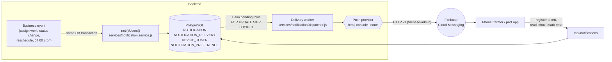
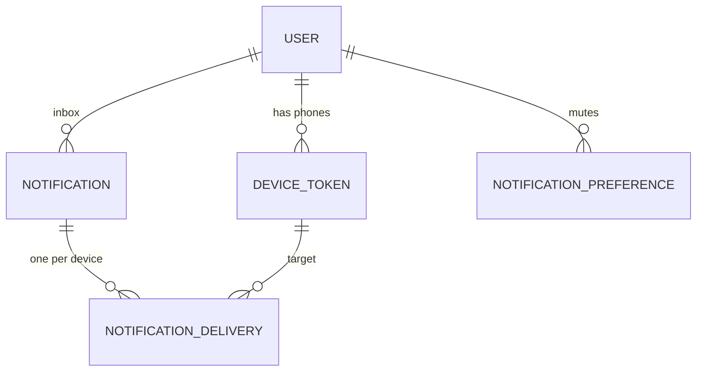
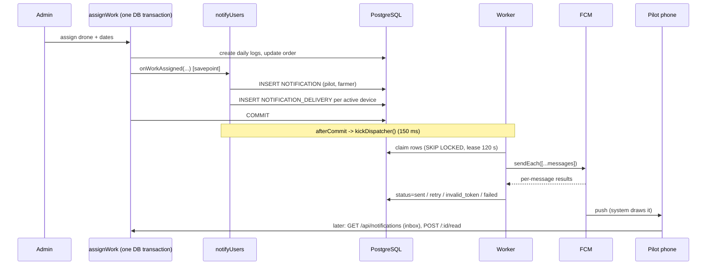

# Push notifications (FCM) — how it works and why it is built this way

This document explains the whole notification system: the backend, the farmer app and the pilot app. It is written
to be *learned from*, so it explains the reasoning, not just the files.

- [1. The 60-second overview](#1-the-60-second-overview)
- [2. Vocabulary](#2-vocabulary)
- [3. Architecture](#3-architecture)
- [4. The data model (four tables)](#4-the-data-model-four-tables)
- [5. Life of a notification, step by step](#5-life-of-a-notification-step-by-step)
- [6. The delivery worker](#6-the-delivery-worker)
- [7. What FCM receives (the payload contract)](#7-what-fcm-receives-the-payload-contract)
- [8. Who gets told what (the events)](#8-who-gets-told-what-the-events)
- [9. The API](#9-the-api)
- [10. The apps](#10-the-apps)
- [11. Setup: connecting a real Firebase project](#11-setup-connecting-a-real-firebase-project)
- [12. Configuration reference](#12-configuration-reference)
- [13. Testing](#13-testing)
- [14. Design decisions and trade-offs](#14-design-decisions-and-trade-offs)
- [15. Security and privacy](#15-security-and-privacy)
- [16. Adding a new notification](#16-adding-a-new-notification)
- [17. Operations and troubleshooting](#17-operations-and-troubleshooting)
- [18. What is not done yet](#18-what-is-not-done-yet)

---

## 1. The 60-second overview

When something happens that a person should know about ("a pilot was assigned to your booking", "you have work
today"), the backend does two separate things:

1. **Records it** in an *inbox* table (`NOTIFICATION`). This is the permanent record. The in-app notification list and
   the unread badge read from it.
2. **Queues a push** (`NOTIFICATION_DELIVERY`) for each of the person's phones. A background **worker** sends the
   queued pushes through **Firebase Cloud Messaging (FCM)**, which wakes the phone and shows the notification.

The two are kept apart on purpose. A push is *best effort* (the phone may be off, the app uninstalled, FCM slow). The
inbox is *reliable*. If a push never arrives, the person still sees the notification in the app.

The inbox row and the queued push are written **in the same database transaction as the business change** that caused
them (e.g. "work assigned"). Either everything is saved or nothing is, so you can never get a notification for
something that was rolled back, or a change without its notification. This pattern is called a **transactional
outbox**.

## 2. Vocabulary

| Term | Meaning |
|---|---|
| **FCM** | Firebase Cloud Messaging: Google's service that delivers a message to an Android phone. |
| **FCM token** (registration token) | A long string that identifies *one app install on one phone*. The backend sends to tokens. Tokens change (app reinstall, data cleared, FCM rotation). |
| **Notification message** | An FCM message with a `notification` block (title/body). Android draws it automatically when the app is closed. |
| **Data message** | The `data` key/value map in a message. The app reads it to know which screen to open. |
| **Channel** | An Android 8+ setting group ("Booking updates"). Users can mute one channel without losing the others. |
| **Outbox** | A table of work still to be done (here: pushes still to be sent), written in the same transaction as the cause. |
| **Dedupe key** | A string that makes the same event unable to notify the same person twice. |
| **Lease** | A time-limited claim on a row so two workers never process it at once, and a crashed worker's rows are recovered. |

## 3. Architecture



Key properties:

- **Decoupled**: a slow or failing FCM never slows or breaks a booking request. The request only writes rows.
- **Scalable**: any number of API servers can run; any number of workers can run. Rows are claimed with
  `FOR UPDATE SKIP LOCKED`, so they never double-send.
- **Recoverable**: failed sends are retried with backoff; a crashed worker's rows are picked up after the lease expires.
- **Provider-agnostic**: the worker talks to a small *provider* interface. `fcm` is real; `console` prints (for
  development); `none` disables pushes while the inbox keeps working.

## 4. The data model (four tables)

Defined in `models/*.js` and created by the migration `migrations/20261101000001-create-push-notification-tables.cjs`
(re-runnable and reversible: `npm run db:migrate` / `db:migrate:undo`).



### `DEVICE_TOKEN` — which phones can be reached
| Column | Why it exists |
|---|---|
| `user_id`, `app` (`farmer`/`pilot`) | Who owns it and which Darhub app registered it. |
| `fcm_token` (**unique**) | The address FCM sends to. Unique across the table: if a different user logs in on the same phone, the *row moves* to them, so pushes follow whoever is logged in. |
| `device_id` | A random id made once per install. When the token rotates, the older token of the same install is retired immediately. |
| `locale` | `en` / `hi`. Picks the language of the notification text. |
| `is_active`, `failure_count`, `last_failure_reason` | A dead token is switched off, not deleted, so delivery history keeps pointing at a real row. |
| `last_seen_at` | Refreshed every time the app registers (twice a day). The nightly job removes tokens unused for 270 days (FCM treats them as stale). |

A user can have several phones; at most 10 are kept active (newest win).

### `NOTIFICATION` — the inbox (source of truth)
One row per notification per person: `type`, `category`, rendered `title`/`body`, `data` (JSON ids for deep-linking),
`priority`, `read_at`, `expires_at`, and `dedupe_key`.

- Indexes: `(user_id, created_on, id)` for the list; a **partial** index on unread rows for the badge count; a
  **partial unique** index `(user_id, dedupe_key)` for deduplication.
- `expires_at`: a "you have work today" reminder is useless tomorrow, so a push still queued after this is dropped.

### `NOTIFICATION_DELIVERY` — the push outbox
One row per notification **per device**. This is the queue the worker drains.

| `status` | Meaning |
|---|---|
| `pending` | Waiting (also: a retry waiting for `next_attempt_at`). |
| `sending` | Claimed by a worker; `locked_until` is its lease. |
| `sent` | FCM accepted it (`fcm_message_id` stored). |
| `invalid_token` | FCM says the device is gone; the `DEVICE_TOKEN` was switched off. |
| `failed` | Retries used up, or an error retrying cannot fix. |
| `expired` | Passed `expires_at` before it could be sent. |

`attempts`, `error_code`, `error_message`, `sent_at` make every push auditable ("why didn't Ramesh get it?").
Unique `(notification_id, device_token_id)` makes queuing idempotent. An index on `(status, next_attempt_at)` keeps the
worker's query fast no matter how big the table grows.

### `NOTIFICATION_PREFERENCE` — what a user muted
`(user_id, category, push_enabled)`. **No row means "on"**, so the table stays small. Categories: `booking`, `work`,
`system`. Types marked `critical` (cancellations, schedule changes) ignore the mute: acting late on them costs money.
A muted category still creates the **inbox row**; only the push is skipped.

## 5. Life of a notification, step by step

Example: the admin assigns work (`POST /order/assign-work/:booking_id`).



What each step guarantees:

1. **Inside the business transaction.** `notifyUsers` runs in the caller's transaction, wrapped in a **savepoint**.
   If rendering a notification throws, only that savepoint is rolled back, the booking still succeeds, and the error
   is logged. (Without the savepoint, one failed SQL statement would poison the whole PostgreSQL transaction.)
2. **After commit** (`transaction.afterCommit`) the worker is woken so the push leaves within ~150 ms. If the process
   dies right then, nothing is lost: the rows are committed and the worker's safety-net poll (every 10 s) finds them.
3. **Dedupe.** Every call can pass a `dedupeKey` (e.g. `WORK_ASSIGNED:<booking>:<dates>`). A retried request or a cron
   that runs twice creates no second notification (`findOrCreate` on the unique `(user_id, dedupe_key)`).
4. **Never notify people about their own action.** Events receive the `actorId` and drop them from the audience.

## 6. The delivery worker

`services/notificationDispatcher.js`. It runs inside each API process (`NOTIFICATION_WORKER_ENABLED=true`) and can
later be moved to its own process by turning that flag off on the web servers and running only workers.

**Claiming** (one atomic statement, safe with many workers):

```sql
UPDATE "NOTIFICATION_DELIVERY" SET status='sending', attempts=attempts+1, locked_until=now()+'120 seconds'
WHERE id IN (
  SELECT id FROM "NOTIFICATION_DELIVERY"
   WHERE (status='pending' AND next_attempt_at <= now())
      OR (status='sending' AND locked_until < now())      -- recover a crashed worker's rows
   ORDER BY next_attempt_at, id LIMIT 200
   FOR UPDATE SKIP LOCKED)                                -- other workers skip rows already locked
RETURNING id;
```

**Sending**: up to 200 messages (FCM's maximum is 500) go out in one `sendEach` call. Each message gets its own result.

**Outcome rules** (`services/push/message.js → classifyFcmError`):

| FCM error | Decision | Why |
|---|---|---|
| `registration-token-not-registered`, `invalid-registration-token`, `sender-id-mismatch` … | **invalid_token**: close the delivery, switch the device off | The app was uninstalled / the token is dead. Retrying is pointless. |
| `internal-error`, `server-unavailable`, `quota-exceeded`, rate limits, network errors | **retry** with exponential backoff (30 s, 1 min, 2 min … max 1 h, +20% jitter) until `NOTIFICATION_MAX_ATTEMPTS` | Transient: it can work later. |
| anything else (bad payload, bad credentials) | **failed** | Retrying will not help; the code is stored for diagnosis. |

If the *whole call* fails (network down, key missing) every row of the batch is retried later.

**Housekeeping** (`services/notificationMaintenance.js`, nightly 03:15 IST): deletes inbox rows older than
`NOTIFICATION_RETENTION_DAYS` (their deliveries disappear with them via `ON DELETE CASCADE`) and dead device tokens.

## 7. What FCM receives (the payload contract)

Built by `buildMessage()` in `services/push/message.js` (pure function, unit-tested):

```json
{
  "token": "<device fcm token>",
  "notification": { "title": "Pilot assigned", "body": "Vikram Shinde will spray your Maize field on 6 Nov – 7 Nov." },
  "data": {
    "type": "PILOT_ASSIGNED", "category": "booking", "notification_id": "<uuid>",
    "booking_id": "<uuid>", "screen": "BOOKING"
  },
  "android": {
    "priority": "high",
    "ttl": 86400000,
    "notification": { "channelId": "darhub_booking", "tag": "<notification id>", "clickAction": "com.darhub.action.OPEN_NOTIFICATION" }
  }
}
```

- **`notification` + `data` together**: the `notification` block makes Android show it even when the app is closed;
  `data` tells the app where to go when it is tapped.
- **All `data` values are strings** (FCM requires it; `stringifyData` converts).
- **`priority: high`** wakes a sleeping phone; `normal` waits for the next wake-up (used for low-urgency updates).
- **`ttl`** = how long FCM keeps it for an offline phone: until the notification's `expires_at`, else 24 h.
- **`channelId`** matches the channels the apps create (`darhub_booking`, `darhub_work`, `darhub_system`).
- **`tag`** = the notification id, so a re-sent push replaces itself instead of piling up.
- **`clickAction`** is the intent action both apps declare on `MainActivity`. It is how a tap on a notification that
  the *system* drew (app closed) opens the app **with the `data` as extras**.

## 8. Who gets told what (the events)

`services/notificationEvents.js` is the single place that decides audience and wording. Texts and behaviour per
type live in `services/notificationTemplates.js` (English + Hindi).

| Event (hook point) | Type | Recipient | Notes |
|---|---|---|---|
| Admin assigns work (`assignWork`) | `WORK_ASSIGNED` | pilot (+co-pilot) | only for new days or days handed to another pilot |
| | `PILOT_ASSIGNED` | farmer | names the pilot |
| Admin books for a farmer (`createOrder`) | `BOOKING_CONFIRMED` | farmer | a farmer booking for themselves is not notified |
| Order → `ORDER_ACCEPTED` (`updateOrderStatus`) | `BOOKING_ACCEPTED` | farmer | |
| Order → `JOB_STARTED` | `JOB_STARTED` | farmer | |
| Order → `JOB_ENDED` | `DAY_COMPLETED` | farmer | |
| Order → `ORDER_COMPLETED` | `JOB_COMPLETED` | farmer | asks for a rating |
| Order → cancelled / rejected | `BOOKING_CANCELLED` | farmer | **critical** |
| | `WORK_CANCELLED` | assigned pilots | **critical** |
| Farmer reschedules (`rescheduleFarmerBooking`) | `WORK_UNASSIGNED` | released pilots | **critical** |
| Cron 07:00 IST | `WORK_TODAY` | pilot with unfinished work today | dedupe key includes the date |
| `POST /api/notifications/admin/send` | `ADMIN_MESSAGE` | one user | testing / announcements |

Because `updateOrderStatus()` is the one function every status change goes through, **new flows get notifications for
free** if they use it. The notification is keyed by the *timeline row* of that status change, so each change notifies
exactly once.

## 9. The API

Mounted at `/api/notifications`; every route needs a signed-in user (farmer or pilot) and only ever touches **that
user's own rows** (the user id comes from the access token, never from the request).

| Method & path | Purpose |
|---|---|
| `POST /devices` | Register / refresh this phone's token (upsert). Body: `fcm_token`, `app`, `device_id`, `app_version`, `os_version`, `locale`. |
| `POST /devices/unregister` | Logout: this phone stops receiving this user's pushes. Idempotent. |
| `GET /` | Inbox, newest first. `?limit=` (≤50) `&before=<next_cursor>` `&unread_only=true`. Returns `items`, `unread_count`, `next_cursor`. |
| `GET /unread-count` | The badge number. |
| `POST /:id/read`, `POST /read-all` | Mark read. Another user's id returns 404 (no probing). |
| `GET /preferences`, `PUT /preferences` | Mute / unmute a category (`booking`, `work`, `system`). |
| `POST /admin/send` | Admin only: send a message to one user and report the delivery result. |

Pagination is **keyset (cursor)**: the cursor encodes `(created_on, id)` of the last row, so pages stay fast and
stable even while new notifications keep arriving (offset pagination would skip/duplicate rows).

## 10. The apps

Both apps contain the same structure (generated from one template so they cannot drift). Package prefix
`com.darhub.darhubfarmer` / `com.darhub.darhubpilot`.

| File (`push/`, `notifications/`) | Responsibility |
|---|---|
| `push/FirebaseBootstrap` | Starts Firebase from four values in `local.properties` (no `google-services.json`, no Gradle plugin). If they are empty, push is simply off and the app runs normally. |
| `push/NotificationChannels` | Creates the 3 Android channels on every start (idempotent). Ids match the backend. |
| `push/PushRegistrar` | `sync()` after login/app start; `onTokenRefreshed()`; `unregisterFromServer()` + `clearLocal()` on logout. Throttled to once per 12 h per token; a failure is retried next start. |
| `push/DarhubMessagingService` | `onNewToken` → re-register. `onMessageReceived` → show a notification when a push arrives while the app is **open**. |
| `push/PushNotificationPresenter` | Builds the notification (channel by category, tap opens `MainActivity`). Checks the Android 13 permission first. |
| `push/PushNavigation` (`PushTarget`) | Reads a tapped notification's intent: which screen, which booking, which notification id. |
| `notifications/NotificationRepository` | The inbox API (page, unread count, mark read). |
| `notifications/NotificationsFragment` + adapter | The list screen: unread dot, relative time, endless scroll, "Mark all read", tap = mark read + open the right tab, tap-to-retry on error. |
| `notifications/NotificationBell` | The bell with the **server's** unread count (same on every device). Home header of both apps. |
| `ui/home/MainActivity` | Asks for the Android 13 notification permission once, registers the token, handles a notification tap (`onNewIntent` / launch), `openNotifications()`. |

### The three ways a push reaches the user

1. **App closed or in the background** → the *system* draws it (because of the `notification` block). Tapping it fires
   `clickAction` → `MainActivity` opens with the `data` extras → the app marks it read and switches to the right tab.
2. **App open** → FCM calls `DarhubMessagingService.onMessageReceived` and the app draws the same notification itself
   (Android does not draw it for a foreground app).
3. **Never delivered** (phone off for days, permission denied) → it is still in the **inbox**, found via the bell.

### Logout and shared phones
A phone must stop receiving the previous user's notifications:
- Logout screen → `PushRegistrar.unregisterFromServer()` (needs the session, 3 s timeout) → then the session is cleared
  and `PushRegistrar.clearLocal()` runs **on every logout path, including an expired session**: it deletes the FCM token
  locally, so FCM rejects any push to the old token (the server then marks it `invalid_token`).
- The next user who logs in gets a fresh token; if the same token were ever registered by someone else the server moves
  the row to the new user.

### Deep-link mapping
The server puts `screen` in `data`. Farmer: `BOOKING`/`ORDERS` → Orders tab. Pilot: `REQUESTS` → Requests tab;
`ORDERS`/`BOOKING` → Orders tab. Unknown → stays on Home. (`MainActivity.openPushTarget`.)

## 11. Setup: connecting a real Firebase project

Until this is done the system runs end to end in **`console` mode** (the worker prints instead of sending) and the apps
do not register tokens. Real delivery needs a Firebase project. One-time steps:

1. **Create a Firebase project** at <https://console.firebase.google.com> (Cloud Messaging is on by default).
2. **Add two Android apps** to it, with these exact package names:
   - `com.darhub.darhubfarmer`
   - `com.darhub.darhubpilot`
3. For **each app**, open *Project settings → Your apps → (the app)* and copy four values into that app's
   `local.properties` (git-ignored, next to `darhub.api.baseUrl`):
   ```properties
   darhub.fcm.projectId=<Project ID>
   darhub.fcm.applicationId=<App ID, looks like 1:1234567890:android:abc123>
   darhub.fcm.apiKey=<Web API Key / current_key from the config>
   darhub.fcm.senderId=<Project number>
   ```
   (These are the same values that are inside `google-services.json`: `project_id`, `mobilesdk_app_id`,
   `current_key`, `project_number`.) Rebuild the app.
4. **Backend credentials**: *Project settings → Service accounts → Generate new private key*. Give the JSON to the
   server as `FCM_SERVICE_ACCOUNT_JSON` (paste the JSON, or its base64) or `FCM_SERVICE_ACCOUNT_FILE=/path/key.json`.
   Set `NOTIFICATION_PROVIDER=fcm` (or leave it unset in production: it picks `fcm` when a key exists).
   **This key is a secret: never commit it, never put it in an app.**
5. **Run the migration**: `npm run db:migrate` (creates the four tables).
6. **Test**: install the app, log in, accept the notification permission, then as an admin
   `POST /api/notifications/admin/send {"user_id": <id>, "title": "Hello", "body": "Test"}`. The response lists each
   device delivery (`sent`, or the FCM error code).

Production release builds also need an HTTPS `darhub.api.baseUrl` (already enforced by the existing Gradle check).

## 12. Configuration reference

| Variable | Default | Meaning |
|---|---|---|
| `NOTIFICATION_PROVIDER` | dev: `console`; prod: `fcm` if a key is set, else `none` | `fcm` / `console` / `none` |
| `FCM_SERVICE_ACCOUNT_JSON` | – | service-account JSON, or its base64 |
| `FCM_SERVICE_ACCOUNT_FILE` | `GOOGLE_APPLICATION_CREDENTIALS` | path to the JSON |
| `NOTIFICATION_WORKER_ENABLED` | `true` | run the delivery worker in this process |
| `NOTIFICATION_POLL_SECONDS` | `10` | safety-net poll interval |
| `NOTIFICATION_BATCH_SIZE` | `200` | messages per FCM call (max 500) |
| `NOTIFICATION_MAX_ATTEMPTS` | `5` | tries per delivery before `failed` |
| `NOTIFICATION_RETENTION_DAYS` | `90` | inbox retention |

Server-side constants: lease `120 s` and `10` batches per run (`notificationDispatcher.js`), max `10` active devices per
user (`deviceToken.service.js`).

## 13. Testing

### Automated (all in `npm test` unless noted)
- `tests/notifications.test.js` (12 tests, pure logic): FCM data stringification, message shape, channel fallback,
  TTL rules, **error classification** (dead token vs retry vs fail), **backoff** math, every template renders in every
  language with no missing variable, every notification type has a template, critical vs mutable types, length limits.
- `tests/integration/notificationDispatcher.integration.test.js` (4 tests, needs a **local** PostgreSQL; it refuses to
  run against a remote DB): a fake FCM answers per token and the test asserts each outcome is recorded — `sent`, dead
  device switched off, transient error retried with a delay, permanent error failed, expired reminder dropped, retry
  limit, **a crashed worker's expired lease is taken over**, **a lease still held is left alone**.
  Run: `ENV_FILE=.env.local node --test tests/integration/notificationDispatcher.integration.test.js`

### What was verified by hand (local server, console provider, Android phone over USB)
- Register devices (farmer + pilot), validation errors, 401 without a token, admin-only `admin/send` (403 for a farmer).
- Real events: assign work → pilot (Hindi, because the phone locale was `hi-IN`) and farmer notified; re-assigning the
  same dates **did not** duplicate; farmer cancel → pilot told, farmer (the actor) not.
- Mute: a muted category creates the inbox row but **no delivery**; a *critical* type is pushed anyway.
- Inbox, unread count, mark read (another user's id → 404), mark all read.
- On the phone: the permission prompt, the bell badge showing the server's unread count, the inbox list, a tap marking
  it read and opening Orders, and the closed-app tap path (`am start -a com.darhub.action.OPEN_NOTIFICATION …`).

### Not verified (be honest about this)
- **A real push through Google's servers to a phone.** This environment has no Firebase project or service-account
  key. The FCM provider code is written against the documented Admin SDK API and is exercised only through the
  provider interface (fake) — the real network path needs step 11. Do this first when you have the project.
- The system-drawn notification and the foreground `onMessageReceived` path on a real FCM message (only the tap intent
  and the inbox were exercised).
- iOS (not built), release builds with minification (this repo builds release with `isMinifyEnabled=false`).

## 14. Design decisions and trade-offs

**Why an inbox *and* pushes?** Pushes are unreliable by nature. An inbox gives a complete history, a real unread
badge, and a place to recover from missed pushes. It is also what makes muting meaningful (mute = no push, still listed).

**Why a transactional outbox instead of calling FCM inside the request?** Calling FCM inside the request couples
booking latency/availability to Google, and can send a push for a transaction that later rolls back (or lose it if the
process dies after commit). Writing rows in the same transaction fixes both. The cost is one extra table and a worker.

**Why `FOR UPDATE SKIP LOCKED` instead of Redis/BullMQ/Kafka?** The project already has PostgreSQL and no queue
infrastructure. SKIP LOCKED gives a correct multi-worker queue with zero new moving parts, and the outbox rows double
as an audit log. If volume ever outgrows it (hundreds of pushes per second), the worker can be replaced by a queue
consumer without changing producers, because producers only call `notifyUsers()`.

**Why per-device delivery rows?** Retries, failures and dead tokens are per *device*, not per notification. One user
with two phones where one is dead must not block or repeat the other.

**Why programmatic Firebase options instead of `google-services.json`?** The plugin adds a Gradle dependency that has
to match the Android Gradle Plugin version, and the file is awkward to keep out of git. Four values in the git-ignored
`local.properties` give the same result, and the apps still build and run with push off.

**Why templates on the server?** Text can change without an app release, languages are chosen per user from the
device locale, and the inbox stores exactly what was sent. The apps stay thin.

**Why savepoint + swallow errors in `notifyUsers`?** Notifications are important but never more important than the
business action. A bug in a template must not stop a booking.

**Why dedupe keys?** At-least-once everywhere (retried HTTP requests, cron on two instances) is normal; the unique
`(user_id, dedupe_key)` index turns "at least once" into "once" for the user.

**Known trade-offs**: delivery is *at-least-once* from the worker's perspective (a crash after FCM accepted but before
the row was updated resends once after the lease expires; the `tag` collapses it on the phone). Ordering between
different notifications is best-effort. The worker shares the API process by default.

## 15. Security and privacy

- Every endpoint authenticates and scopes to `req.auth.id`. No endpoint accepts a `user_id` for reading/changing
  inbox, devices or preferences. Only `admin/send` takes a target user, and it requires an admin.
- Tokens are not secrets between apps but are *capabilities to push to a phone*: they are only ever stored server-side,
  only the owner can unregister theirs, and a token moves to a new user on re-registration (shared-phone safety).
- The FCM **service-account key** can send to *any* of your users: keep it in the host's secret store, never in git or
  an app. The apps contain only public client identifiers.
- Notification text can contain names and places and shows on lock screens. Templates deliberately avoid phone
  numbers, amounts and addresses.
- Input is validated (zod): token length, `app`/`platform` enums, pagination limits, preference categories.
- `PUT /preferences` can never silence `critical` types.

## 16. Adding a new notification

Example: tell the farmer when the pilot is 30 minutes away.

1. `utils/notificationTypes.js`: add `PILOT_NEARBY`.
2. `services/notificationTemplates.js`: add an entry with `category`, `priority`, `ttlHours`, `critical` (if it must
   ignore mute), `text: { en, hi }`, and `data` (`booking_id`, `screen`). The unit tests fail if a language is missing a
   variable or a type has no template.
3. `services/notificationEvents.js`: add `onPilotNearby({ order, transaction })` that picks the audience and calls
   `notifyUsers({ userIds, type, vars, dedupeKey, transaction })`. Choose a `dedupeKey` that is unique *per real event*.
4. Call it from the place the event happens, passing the surrounding `transaction`. If the event is an order status
   change, you usually need nothing: extend the mapping in `onOrderStatusChanged`.
5. If it opens a new screen, add the `screen` name to `MainActivity.openPushTarget` in the app(s).

## 17. Operations and troubleshooting

**"Why didn't X get a push?"** Look at the rows:
```sql
SELECT n.type, n.title, d.status, d.attempts, d.error_code, d.error_message, t.is_active, t.last_seen_at
FROM "NOTIFICATION" n
LEFT JOIN "NOTIFICATION_DELIVERY" d ON d.notification_id = n.id
LEFT JOIN "DEVICE_TOKEN" t ON t.id = d.device_token_id
WHERE n.user_id = <id> ORDER BY n.created_on DESC LIMIT 20;
```

| Symptom | Likely cause |
|---|---|
| Notification in the inbox but **no delivery row** | the user has no active device, muted the category (non-critical), or `NOTIFICATION_PROVIDER=none` |
| `status=pending` for long | worker disabled/not running; or retrying (`next_attempt_at`, `error_code`) |
| `status=failed`, `messaging/third-party-auth-error` | wrong/missing service-account key, or FCM API not enabled for the project |
| `status=invalid_token` | app uninstalled / token rotated: expected; the device was switched off |
| `status=sent` but nothing on the phone | notification permission denied (Android 13+), channel muted in system Settings, battery optimisation, or the app is configured for a *different* Firebase project than the key (sender mismatch) |
| App never registers a token | `local.properties` FCM values empty (push off), user not logged in, or offline (retried next start) |

**Monitoring to add in production**: alert on `failed` deliveries per hour, the age of the oldest `pending` row
(worker health), share of `invalid_token`, and `[push]` errors in logs.

**Scaling**: add API instances freely. To isolate load, set `NOTIFICATION_WORKER_ENABLED=false` on web instances and
run a few dedicated worker processes. For very large audiences (announcements to everyone) use FCM **topics** or
batch creation instead of one `notifyUsers` call per person.

## 18. What is not done yet

- **A real FCM round trip** (needs your Firebase project, section 11).
- An **in-app settings screen** for mute switches (the API `GET/PUT /preferences` exists; the existing profile toggle
  `isNotificationsEnabled` is not wired to it).
- **Rich notifications** (images, action buttons), **grouping**, and **notification sounds** per channel.
- **Admin-panel UI** to compose announcements (the `admin/send` endpoint exists).
- **iOS** (APNs) and **web push**.
- A **dedicated worker process** (the flag exists; the entry point is the same `server.js`).
- Notifications for events that have no server flow yet: payments/invoices (no payment API exists), pilot "arrived/on
  the way" (the live-tracking steps are only local in the pilot app today).

## File map (backend)

```
models/DeviceToken.js, Notification.js, NotificationDelivery.js, NotificationPreference.js
migrations/20261101000001-create-push-notification-tables.cjs
config/env.js                                  NOTIFICATION_* / FCM_* settings
utils/notificationTypes.js                     the type and category constants
services/push/message.js                       payload builder, error classification, backoff (pure)
services/push/providers/{fcm,console}.provider.js, services/push/index.js
services/notificationTemplates.js              texts (en/hi), category, priority, critical, ttl
services/notification.service.js               notifyUsers(): inbox + outbox rows, savepoint, dedupe, mute
services/notificationEvents.js                 who is told what, per business event
services/notificationDispatcher.js             the worker: claim, send, record, retry
services/notificationMaintenance.js            nightly cleanup
services/deviceToken.service.js                register / unregister phones
controllers/notification.controller.js, routes/notificationRoutes.js, validation/notification.schemas.js
cron/jobs.js                                   starts the worker; 07:00 reminders; 03:15 cleanup
utils/orderUtils.js                            updateOrderStatus() calls onOrderStatusChanged()
controllers/availabilityController.js          assignWork -> onWorkAssigned()
controllers/farmerBookingController.js         reschedule -> onWorkUnassigned()
controllers/Admin.controller.js                admin-created booking -> onBookingCreatedByAdmin()
tests/notifications.test.js, tests/integration/notificationDispatcher.integration.test.js
```
